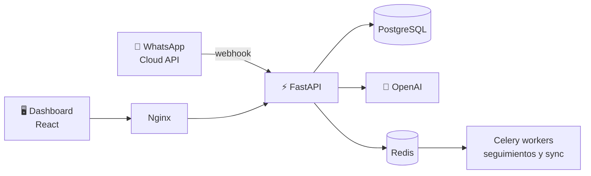

<div align="center">

# 💬 SignalDesk AI

**Atención por WhatsApp con inteligencia artificial para negocios**

[](https://github.com/virginiacastellano/SignalDesk-AI/actions/workflows/tests.yml)


</div>

## 💡 Mi idea

Muchos negocios atienden a sus clientes por WhatsApp a mano: responden las mismas preguntas una y otra vez, pierden consultas fuera de horario y no tienen un registro ordenado de quién preguntó qué.

SignalDesk AI es una plataforma SaaS que construí para resolver eso: **un bot con inteligencia artificial responde, organiza los contactos como potenciales clientes y deriva a una persona cuando hace falta**. Varios negocios pueden usar la misma plataforma, cada uno con sus datos separados.

## ✨ Qué hace

- 🤖 **Bot con IA:** responde con el contexto de la conversación y detecta cuándo derivar a una persona.
- 📋 **Menús interactivos de WhatsApp** configurables desde un panel (bienvenida, respuestas, palabras clave).
- 👥 **CRM de contactos:** historial de conversaciones, etiquetas y estado de cada potencial cliente.
- ⚙️ **Workflows:** reglas, seguimientos automáticos y asignación al equipo.
- 📊 **Analítica** en un dashboard.
- 🏢 **Multi-tenant:** cada negocio ve solo sus datos, con usuarios y roles (owner, admin, agente, analista).
- 🔌 **Integraciones simuladas** con Google Sheets, Gmail y CRM, listas para conectar las reales.

## 🏗️ Arquitectura



El backend sigue una arquitectura en capas:

- `api/`: rutas de FastAPI e inyección de dependencias
- `services/`: casos de uso (autenticación, conversaciones, analítica, workflows)
- `domain/`: modelos de SQLAlchemy y esquemas de Pydantic
- `infrastructure/`: base de datos, repositorios y adaptadores de WhatsApp y OpenAI
- `workers/`: tareas en segundo plano con Celery

Los proveedores externos están detrás de **adaptadores**: si faltan las credenciales de WhatsApp, los envíos se simulan y la demo funciona igual. La IA devuelve siempre la misma estructura (`reply`, `intent`, `handoff_required`), así el resto del sistema no depende de un modelo en particular.

Más detalle en [docs/ARCHITECTURE.md](docs/ARCHITECTURE.md).

## ▶️ Cómo correrlo

Requiere Docker.

```bash
cp backend/.env.example backend/.env
docker compose up --build
docker compose exec backend python -m app.seeds.seed_demo
```

- Dashboard: http://localhost:5173
- Documentación de la API: http://localhost:8000/docs
- Gateway Nginx: http://localhost:8080

Usuario de la demo, creado por el seed (solo para uso local):

```text
founder@novagrowth.io
Password123!
```

### Recorrido de la demo

1. Iniciá sesión y tocá **Reset demo**.
2. En el simulador de WhatsApp, usá el preset **Menu** y elegí **Planes y precios**.
3. Respondé como agente desde el compositor.
4. Cambiá el mensaje de bienvenida en **Bot Builder**, guardá y volvé a simular **Menu**.

Más detalle en [docs/DEMO_FLOW.md](docs/DEMO_FLOW.md).

## 🔌 Conectar servicios reales

En `backend/.env`:

```env
# WhatsApp Cloud API
WHATSAPP_PHONE_NUMBER_ID=
WHATSAPP_BUSINESS_ACCOUNT_ID=
WHATSAPP_ACCESS_TOKEN=
WHATSAPP_VERIFY_TOKEN=
PUBLIC_WEBHOOK_URL=

# OpenAI
OPENAI_API_KEY=
OPENAI_MODEL=
```

El webhook de Meta se configura en `https://tu-dominio.com/api/v1/whatsapp/webhook`.

## 🧪 Tests

```bash
cd backend
python -m pytest
```

Cubren el health check, la configuración por defecto del bot y la seguridad: hash de contraseñas, tokens JWT con tenant y rol, rechazo de tokens alterados y control de permisos por rol. Corren en GitHub Actions con cada cambio.

## 🗺️ Próximos pasos

- [ ] Migraciones con Alembic
- [ ] Row Level Security en PostgreSQL para reforzar el aislamiento entre negocios
- [ ] Claves de idempotencia para los webhooks de WhatsApp
- [ ] Trazabilidad con OpenTelemetry
- [ ] Facturación y suscripciones (Mercado Pago o Stripe)
- [ ] Más tests de servicios y endpoints

---

<div align="center">

Hecho con 💜 por [Virginia Castellano](https://github.com/virginiacastellano)

</div>
